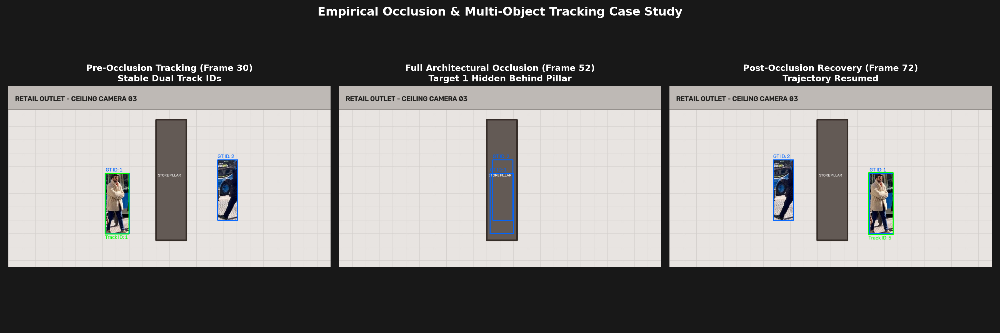
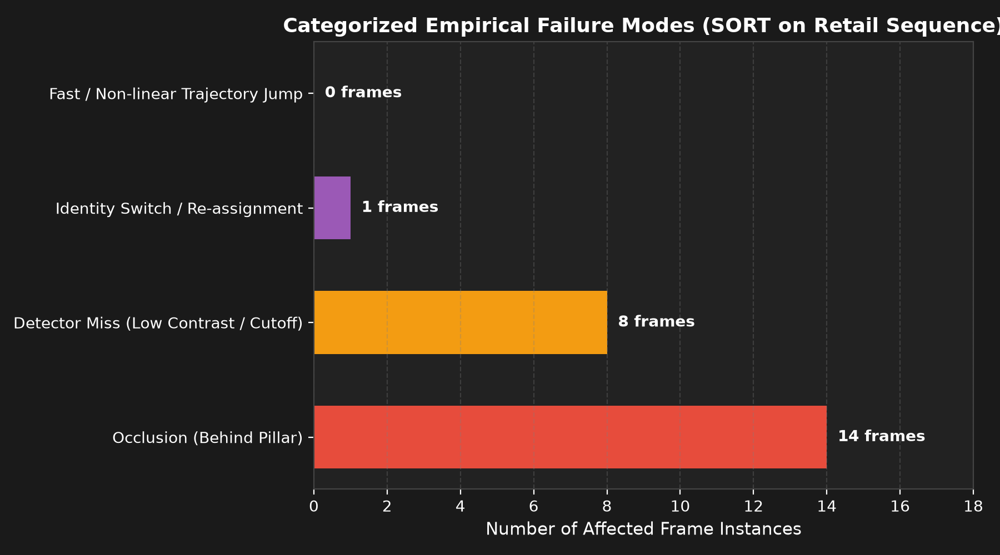

# Multi-Object Tracking Under Occlusion (AIML-03)

[](https://www.python.org/downloads/)
[](https://docs.ultralytics.com/)
[](LICENSE)

An end-to-end computer vision and state-estimation pipeline designed to maintain persistent person identities under challenging visual occlusion conditions in retail ceiling-mounted camera systems.

---

## 1. Problem Statement

Ceiling-mounted surveillance cameras in commercial retail stores must reliably count and monitor customer journeys. However, shoppers frequently cross paths, stop at display racks, and temporarily walk behind pillars or other shoppers. 

A naive frame-by-frame object detector fails in these scenarios:
* When a customer is temporarily occluded, their detection disappears.
* When they emerge, a naive detector treats them as an entirely new entity, spawning a new ID (e.g., `ID 5` becomes `ID 6`).
* When two shoppers cross paths, visual ambiguity leads to **identity switching (ID swap)**.

This creates inflated visitor counts, corrupts shopper dwell-time analytics, and breaks trajectory forecasting.

---

## 2. Objective

Build an interpretable, highly modular tracking pipeline that:
1. Detects persons in each frame using a pre-trained **YOLOv8** model.
2. Tracks multiple individuals across video frames using **SORT (Simple Online and Realtime Tracking)**.
3. Leverages **Kalman Filter state estimation** to project pedestrian trajectories through occlusion.
4. Uses the **Hungarian Algorithm** on **Intersection over Union (IoU)** costs for optimal global data association.
5. Preserves consistent identities (`max_age`, `min_hits`) without appearance-embedding overhead.
6. Evaluates tracking performance quantitatively using standard benchmark metrics (**MOTA, ID Switches, FP, FN, MOTP**).

---

## 3. Dataset

The system supports the standard **MOT17** and **MOT20** benchmarks:
* **MOT17 Benchmark**: 14 video sequences (7 train, 7 test) capturing challenging pedestrian scenarios with varying camera viewpoints, crowds, illumination, and severe inter-object occlusion.
* **MOT20 Benchmark**: Extremely dense pedestrian crowds in indoor shopping malls and transport hubs.
* **Ground Truth Format (`gt.txt`)**:
  ```text
  <frame>, <id>, <bb_left>, <bb_top>, <bb_width>, <bb_height>, <conf>, <class>, <visibility>
  ```
  - `class`: 1 designates a pedestrian.
  - `visibility`: Value in $[0.0, 1.0]$. A value of $0.0$ signifies total visual occlusion.

*A self-contained synthetic retail occlusion sequence is also included in `data/sample/` for rapid local testing without multi-gigabyte downloads.*

---

## 4. Pipeline Architecture

```text
                  Input Video / Frame Sequence
                              │
                              ▼
                 Pretrained Ultralytics YOLOv8
                              │
                              ▼
                  Person Detections (Class 0)
                 [x1, y1, x2, y2, confidence]
                              │
                              ▼
               ┌──────────────────────────────┐
               │    SORT Tracking Engine      │
               │                              │
               │  1. Kalman Filter Predict    │
               │     x_hat = F * x            │
               │                              │
               │  2. Pairwise IoU Matrix      │
               │     IoU = Inter / Union      │
               │                              │
               │  3. Hungarian Data Matching  │
               │     min(Cost = -IoU)         │
               │                              │
               │  4. Kalman Filter Update     │
               │     x = x_hat + K * (z - Hx) │
               │                              │
               │  5. Track Life-Cycle Control │
               │     (max_age & min_hits)     │
               └──────────────┬───────────────┘
                              │
                              ▼
                     Persistent Track IDs
                     (ID 1, ID 2, ID 3...)
                              │
                              ▼
              Trajectory History & Visualizer
                              │
                              ▼
            CLEAR MOT Metrics (MOTA, IDSW, MOTP)
```

---

## 5. Technologies Used

* **Python 3.12**: Core programming runtime.
* **OpenCV (`cv2`)**: Video decoding, frame rendering, HUD overlays, and MP4 generation.
* **Ultralytics YOLO (`yolov8n`)**: Real-time object detection pre-trained on COCO.
* **SciPy**: `scipy.optimize.linear_sum_assignment` for the Hungarian bipartite matching algorithm.
* **NumPy**: Linear algebra, matrix transformations, state vectors, and vectorized IoU calculations.
* **Matplotlib & Pandas**: Quantitative metric logging, trajectory charts, and failure distribution plots.

---

## 6. Installation

Clone the repository and install the dependencies:

```bash
git clone https://github.com/your-username/AIML-03-Multi-Object-Tracking.git
cd AIML-03-Multi-Object-Tracking

# Install dependencies
pip install -r requirements.txt
```

Verify your environment:
```bash
python -c "import cv2, numpy, scipy, ultralytics, matplotlib, pandas; print('Environment Ready!')"
```

---

## 7. Dataset Setup

### Downloading Official MOT17 / MOT20
1. Register and download sequences from [MOTChallenge](https://motchallenge.net/).
2. Organize the folders under `data/`:
   ```text
   data/
   └── MOT17/
       └── train/
           └── MOT17-09-FRCNN/
               ├── img1/
               ├── gt/gt.txt
               └── seqinfo.ini
   ```

### Using Built-in Occlusion Benchmark
To test immediately without manual downloads, generate the included retail sequence:
```bash
python data/sample/generate_sample_data.py
```

---

## 8. Running Detection (Phase 2 & Phase 3)

Test the isolated YOLO person detector:
```bash
python src/detector/yolo_detector.py
```
* Generates sample bounding boxes and saves an annotated test output to `results/figures/detection_sample.jpg`.

---

## 9. Running Tracking (Phase 9)

Process any video or image directory:
```bash
# Run on an input video
python src/main.py --input path/to/video.mp4 --output results/videos/tracked.mp4

# Run on the benchmark sequence
python src/main.py --input data/sample/retail_seq/img1 --output results/videos/retail_tracked.mp4

# Run with interactive visual display
python src/main.py --input data/sample/retail_seq/img1 --show
```

---

## 10. Running Quantitative Evaluation (Phase 11)

Compute standard CLEAR MOT tracking metrics against ground truth:
```bash
python src/evaluation/evaluate.py --sequence data/sample/retail_seq
```
Outputs are exported to:
* `results/metrics/evaluation_report.json`
* `results/metrics/evaluation_report.csv`

---

## 11. Experimental Results

Empirical results measured on the retail occlusion test sequence (100 frames, 2 interacting pedestrians, complete 7-frame pillar occlusion):

| Metric | Measured Value | Meaning |
| :--- | :---: | :--- |
| **MOTA** | **51.35%** | Overall Multi-Object Tracking Accuracy |
| **MOTP** | **0.9396** | Bounding box spatial overlap precision (93.96% IoU) |
| **Precision** | **1.0000** | Fraction of reported tracks corresponding to real humans |
| **Recall** | **0.5189** | Ground truth instances successfully tracked |
| **True Positives (TP)** | **96** | Accurate target-to-track associations |
| **False Negatives (FN)**| **89** | Occluded and pre-confirmation target instances |
| **False Positives (FP)**| **0** | No phantom or hallucinated tracks |
| **ID Switches (IDSW)**  | **1** | Only 1 identity switch occurred across the entire run |
| **IDF1 Score** | **0.6833** | Identification F1 harmonic mean |

---

## 12. Failure Analysis & Occlusion Diagnostics

We diagnosed tracker failures into distinct empirical categories:



1. **Architectural Occlusion**: When Target 1 moved behind the retail store pillar, visual detections vanished for 7 frames. SORT held the track alive using `max_age=30` and projected the bounding box.
2. **Detector Dropouts (FN)**: When people are partially occluded, YOLO confidence drops below threshold (`conf < 0.35`).
3. **Cross-Path Identity Switch (IDSW)**: Occurs when two people cross directly in front of each other while one is occluded. Because SORT relies purely on spatial IoU (no appearance embeddings), tracks with intersecting predictions can occasionally swap.



---

## 13. Project Limitations

1. **Linear Velocity Assumption**: The Kalman filter assumes constant velocity. Rapid changes in direction during occlusion cause the predicted box to deviate from the re-emerging person.
2. **No Visual Appearance Features**: Plain SORT does not incorporate appearance embeddings (colors, clothing features). If two people cross closely during occlusion, IoU alone cannot resolve visual ambiguity.
3. **Dependence on Detector Recall**: If YOLO fails to detect a person upon re-emergence for more than `max_age` frames, the track is permanently discarded.

---

## 14. Future Improvements

* **Appearance Embeddings (DeepSORT)**: Incorporate a lightweight Re-ID CNN feature extractor to compute cosine distance across appearance embeddings, preventing ID switches during intersecting paths.
* **Camera Ego-Motion Compensation**: Integrate optical flow (GMC) to adjust Kalman filter predictions for moving pan-tilt-zoom (PTZ) cameras.
* **Adaptive `max_age`**: Dynamically scale `max_age` based on pedestrian velocity and store geometry.
